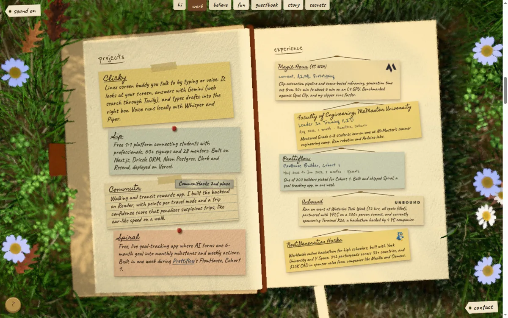
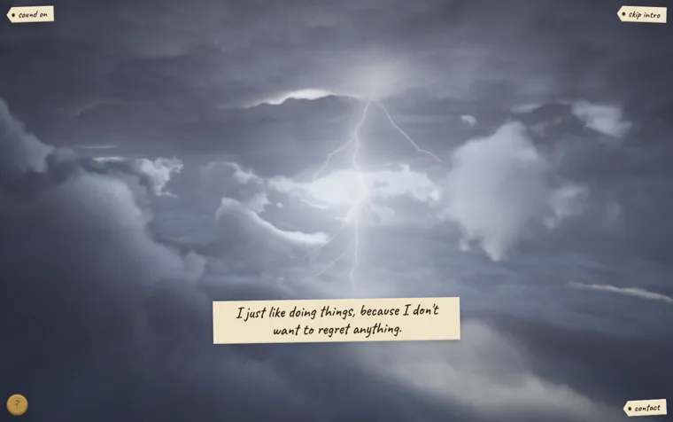
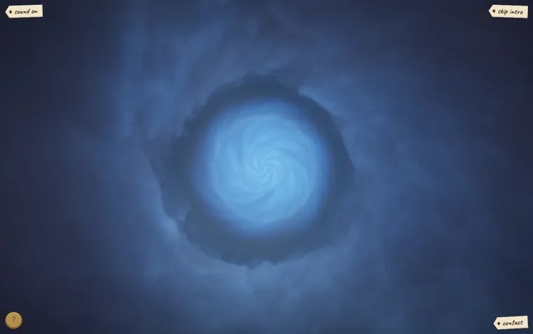

<div align="center">

# Shahmeer's notebook

My personal portfolio: a worn leather notebook lying open in a garden, built to scroll through like a real book.


**Live site:** _coming soon_

</div>

<p align="center">
  
</p>

<p align="center">
  
  &nbsp;
  
</p>

## What it is

You start inside a storm. Tap once and you're flying between two decks of dark cloud while a short voiceover plays with captions. Lightning flickers deep inside the clouds, gets closer as the voice builds, and then one big bolt comes down right in front of you. After that it goes quiet, a blue opening appears in the cloud wall like the calm eye of the storm, and it pulls you through a tunnel of cloud into daylight. You land in a sunny garden with a leather notebook lying in the grass. Scroll and the cover opens, then the pages turn one by one.

<p align="center">
  
  &nbsp;
  
</p>

There are seven pages:

1. **Hi**, who I am and what I'm doing right now
2. **My story**
3. **Work**, the things I've built, where I've worked and my GitHub
4. **What I believe**
5. **Fun**, songs, books and hobbies
6. **Guestbook**, leave me a note
7. **Secrets**, for whatever you found in the garden

The storm has wind and thunder under the voice, and the garden has birds. Nothing makes a sound until you've tapped in, and there's a tag in the corner to mute all of it. The skip intro button is there from the very first screen if you just want the book.

It was built for phones first. On a phone the book shows one page at a time and the camera slides across the spread. Devices that can't run the 3D scene smoothly, and anyone with reduced motion turned on, get a flat version instead: a still photo of the same garden and book with a simple page turn.

The lightning is kept gentle on purpose. It never flashes more than three times in a second, it never turns the whole screen white, and if you have reduced motion turned on (or your device is on the slow tier) you get the same storm with no flashes at all.

## Things to find

- A live GitHub contributions graph, pulled through the site's own server route
- Song previews you can play right on the page, from iTunes, with Deezer as a backup for browsers that can't play Apple's files
- A guestbook where notes only show up after I approve them
- Hidden daisies in the garden. Find them and they show up on the last page
- A contact tag in the corner with my LinkedIn and email
- A chat bubble in the bottom left. It's only a placeholder for now

## Built with

- [Next.js](https://nextjs.org) 16.4.6 and React 19.3, in TypeScript
- [Three.js](https://threejs.org) 0.187 for the garden and the book
- [GSAP](https://gsap.com) 3.15 with ScrollTrigger, and [Lenis](https://lenis.darkroom.engineering) 1.3 for smooth scrolling
- [Neon](https://neon.tech) Postgres for the guestbook
- Three handwriting fonts from Google Fonts: Caveat, Reenie Beanie and Homemade Apple

The storm and the portal are pre-rendered frames (WebP) played on a canvas, so they look the same on a cheap phone as on a desktop. They come from a volumetric cloud renderer I run offline in headless Chrome (`scripts/storm/`): a raymarched cloud volume shaped with Perlin-Worley noise and lit with proper scattering, at far more steps and samples than a phone could do live. Each lightning flash is its own layer of frames holding only the light it adds to the clouds, and the site fades those layers in time with the voice. That's why the flashes can be switched off without changing anything else.

The whole intro is about 12 MB of frames on a desktop (1280x720) and under 4 MB on a phone (608x1080, upright), and it starts playing as soon as the first few have arrived. Two small scripts keep it honest: `scripts/storm/check-flashes.mjs` plays the real frames against the lightning timeline and fails if anything flashes more than three times in a second or turns more than a quarter of the screen white, and `scripts/storm/check-loudness.mjs` listens to the running site and fails if the thunder or wind ever comes within 6 LU of the voice. Before and after stills of the rebuild are in `docs/intro/`.

## Run it locally

You'll need Node 20 or newer.

```bash
npm install
cp .env.example .env.local
```

Then fill in `.env.local`:

| Name | What it's for |
|---|---|
| `GITHUB_TOKEN` | A read-only GitHub token, used for the contributions graph |
| `DATABASE_URL` | A Neon Postgres connection string, used for the guestbook |
| `ADMIN_PASSWORD` | The password for `/admin`, where guestbook notes get approved |

The site still runs without them. The graph and guestbook just stay empty.

```bash
npm run dev      # http://localhost:3000
npm run build    # production build
npm start        # serve the build
```

## Where things live

```
app/            pages, styles and the API routes (github, songs, guestbook)
app/admin/      the private page for approving guestbook notes
components/
  intro/        tap to begin, storm frames, lightning timeline, voiceover and captions
  scene/        the Three.js garden, the book and the page-turn rig
  pages/        the seven notebook pages
  ui/           contact tag, mute, chat bubble, page tabs
content/site.ts every word on the site, in one file
lib/            scroll plan, sound, songs lookup, database
public/         frames, textures, audio, logos and the flat fallback image
scripts/        how the storm frames and the fallback still were made
```

## Credits

- Leather, ground and the `meadow_2` HDRI sky from [Poly Haven](https://polyhaven.com) (CC0)
- Paper, grass, daisy and leaf cut-outs from [ambientCG](https://ambientcg.com) (CC0)
- The garden sound is "Birds singing in garden" by ezwa on [Wikimedia Commons](https://commons.wikimedia.org), released into the public domain
- The thunder, the wind and the portal swoosh are not recordings. They're made in the browser with the Web Audio API (`lib/sound.ts`)
- The voiceover was made with [ElevenLabs](https://elevenlabs.io)
- Song previews come from the iTunes Search API, with [Deezer](https://www.deezer.com) as the fallback
- Company logos belong to their owners and were taken from their own sites

## Say hi

- LinkedIn: [shahmerrkhann](https://www.linkedin.com/in/shahmerrkhann/)
- GitHub: [shahmerrkhan](https://github.com/shahmerrkhan)
- Email: [m.shahmeer.khan8@gmail.com](mailto:m.shahmeer.khan8@gmail.com)

Or just leave a note in the guestbook.
